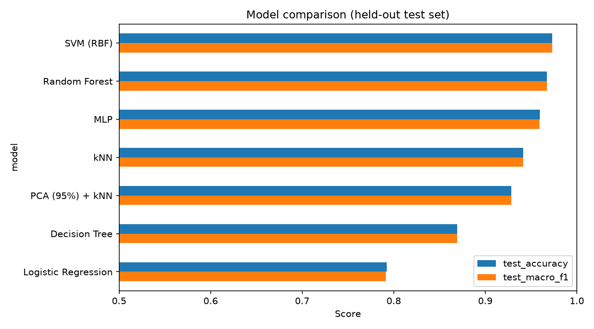
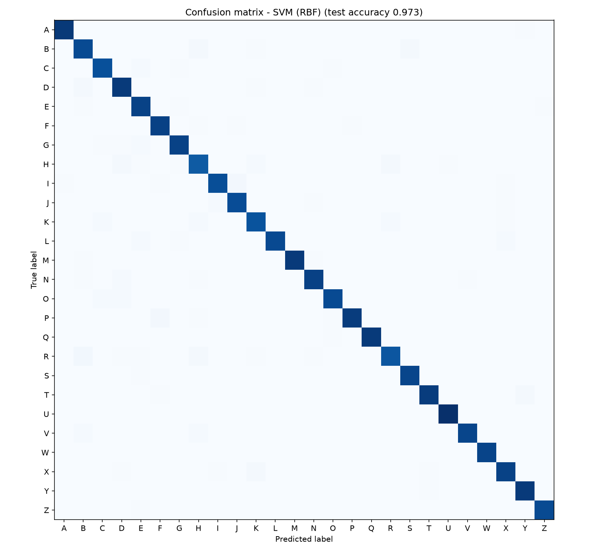

# Letter Recognition ML

End-to-end machine learning pipeline that recognises capital letters **A–Z** from 16 numeric
shape features, comparing **7 models** on the same stratified train/test split.

**Best result: SVM (RBF) with 97.3% test accuracy** (macro-F1 0.973) on 4,000 unseen letters.



---

## Problem

Optical character recognition (OCR) turns images of characters into text. This dataset has
already reduced each letter image to **16 integer features** (box size, pixel counts, statistical
moments, edge counts). The task: predict which of the **26 letters** each row is.

## Dataset

- **UCI Letter Recognition** (Slate, 1991): 20,000 rows, 16 features + 1 target, no missing values
- Classes are close to balanced (roughly 730–810 rows per letter), so **accuracy is a fair metric**;
  macro-F1 is reported too and confirms it (the two scores match within 0.001 for every model)
- The data is downloaded automatically by `src/data.py` and is **not stored in this repo**

## Approach

```
src/data.py        download + load (20,000 x 17)
      │
src/features.py    + 5 engineered features → 21 features
      │
src/preprocess.py  stratified 80/20 split → StandardScaler fitted on TRAIN only
      │
src/train.py       GridSearchCV (3-fold) per model → evaluate once on the test set
      │
reports/           metrics.csv + charts
```

**Engineered features** (ratios floor the denominator at 1 to avoid huge values when it is 0):

| Feature | Formula | Idea |
|---|---|---|
| `box_area` | width × height | size of the letter's box |
| `aspect_ratio` | width ÷ height | wide letters (W, M) vs narrow ones (I, J) |
| `pixel_density` | onpix ÷ box_area | how filled-in the box is |
| `edge_ratio` | x_edge ÷ y_edge | horizontal vs vertical edges |
| `total_variance` | x2bar + y2bar | overall spread of the "on" pixels |

**No data leakage:** the split happens before scaling, the scaler only sees training rows, and
hyperparameters are tuned with cross-validation on the training set. The test set is used once.

## Results

| Model | Best params | CV accuracy | Test accuracy | Test macro-F1 |
|---|---|---|---|---|
| **SVM (RBF)** | C=10 | 0.962 | **0.973** | **0.973** |
| Random Forest | 300 trees | 0.957 | 0.967 | 0.967 |
| MLP | layers (128, 64) | 0.951 | 0.960 | 0.959 |
| kNN | k=1 | 0.927 | 0.941 | 0.941 |
| PCA (95% variance) + kNN | k=1 | 0.910 | 0.928 | 0.928 |
| Decision Tree | max_depth=None | 0.848 | 0.869 | 0.869 |
| Logistic Regression | C=10 | 0.783 | 0.792 | 0.792 |

**What the results mean**
- **Non-linear models win.** Logistic Regression draws straight-line boundaries and stalls at 79%;
  SVM with an RBF kernel draws curved ones and reaches 97%.
- **Ensembles beat single trees.** Random Forest (many trees voting) gains 10 points over one tree.
- **PCA trade-off.** Keeping 95% of the variance drops kNN by only 1.3 points, a useful
  compression when memory or speed matters.
- **Most confused pairs (SVM):** R→B, P→F, I→J, X→K, D→B. These letters really do share strokes.



## Save & predict

After training, the best model is saved so it can be used without retraining:

```
src/train.py   → models/best_model.joblib
                 { pipeline: StandardScaler + SVM,  model_name,  test_accuracy,  features }
src/predict.py → load bundle → add the 5 engineered features → pipeline.predict()
```

- **Scaler and model are saved together** as one scikit-learn `Pipeline`, so new data is scaled
  with exactly the numbers learned from the training set (no training–serving skew).
- **The feature list is saved too**, so columns always arrive in the same order as in training.
- `models/` is ignored by Git (`models/*`, except `.gitkeep`): the file is rebuilt by `python -m src.train`.
- The demo predicts 10 rows from the **test set**, recreated with the same split and seed, so the
  model has never seen them. If no saved model exists, it stops with a clear `FileNotFoundError`.

Example output:

```
Model: SVM (RBF) (test accuracy 0.973)

  true = I   predicted = I   OK
  true = X   predicted = X   OK
  true = S   predicted = S   OK
  true = T   predicted = T   OK
  ...      (10/10 correct in this run)
```

## How to run

```bash
git clone https://github.com/Danishiyan/letter-recognition-ml.git
cd letter-recognition-ml
python3.12 -m venv .venv
source .venv/bin/activate
pip install -r requirements.txt

python -m src.train      # downloads the data, trains all 7 models (~1 min), writes reports/ + models/
python -m src.predict    # loads the saved model and predicts 10 unseen letters
```

Exploration notebook: `notebooks/01_eda.ipynb`

## Project structure

```
├── data/            raw/ and processed/ (not in Git)
├── models/          best_model.joblib (not in Git, created by src.train)
├── notebooks/       01_eda.ipynb
├── reports/         metrics.csv, figures/
├── src/             data.py, features.py, preprocess.py, train.py, predict.py
└── requirements.txt
```

## Limitations and next steps

- One train/test split; nested cross-validation would give firmer confidence intervals
- Small hyperparameter grids; a wider or randomised search could improve SVM and MLP further
- Next: wrap the best model in a **FastAPI** endpoint and containerise it with **Docker**

## Licence

MIT. Dataset: UCI Machine Learning Repository, *Letter Recognition* (D. J. Slate, 1991).
